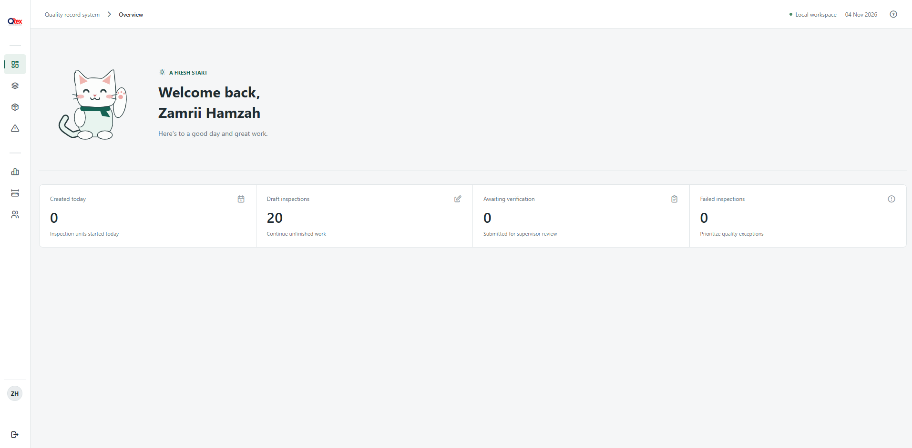
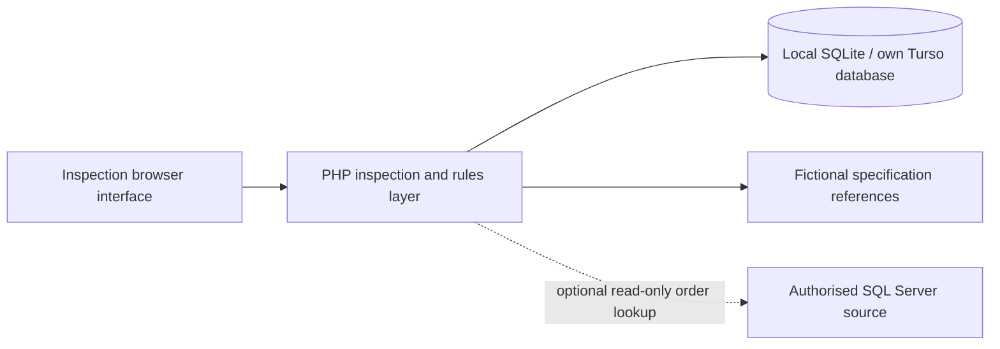

# QREX — CPETPE & HDPE Inspection System

Finished-goods inspections with sales-order context, repeated measurements, visual-defect capture, dispositions, and inspection reports.

**Role:** Software Development Intern · Quality Assurance (IT)  
**Built with:** PHP 8.1+, JavaScript, CSS, SQLite / Turso libSQL, optional SQL Server lookup  
**Project:** Industry experience · 2026

## Overview

Finished-goods inspection requires an order context, the correct product measurements, visual-defect records, and an understandable disposition. QREX organises those activities around individual CPETPE and HDPE inspection units.

## My contribution

Developed the system from project requirements during my internship at Top Glove, including interfaces, backend workflow logic, database integration, debugging, and user acceptance testing.

## Features

| Capability | What it supports |
| --- | --- |
| Order context | Connect authorised sales-order lookup results with inspection-unit records. |
| CPETPE and HDPE | Product-specific entry flows support different inspection measurements and visual checks. |
| Repeated readings | Record raw measurements and calculate results against the selected specification snapshot. |
| Visual defects | Capture defect quantities by category and show the resulting disposition. |
| Workflow state | Retain inspection progress and protect completed or verified records from normal edits. |
| Reports | Review inspection details and prepare the application’s print-friendly inspection output. |

## Workflow

A user selects an order and inspection unit, records product-specific measurements and defects, and reviews the resulting disposition. Submitted or completed inspections retain their recorded context for subsequent review and reporting.

## Architecture

## Source guide

| Path | Responsibility |
| --- | --- |
| `app/` | Inspection persistence, rules, sampling, reporting, and database adapters |
| `public/` | Web entrypoint, frontend JavaScript, styles, and assets |
| `config/` | Environment-backed settings and a private configuration template |
| `resources/master.json` | Fictional product references, limits, and defect definitions |
| `tools/install.php` | Local database installation and administrator setup |

## Portfolio export

This is a separate, cleaned source snapshot for code review. The working internal application remains untouched. Private configuration, credentials, uploaded evidence, operational logs, database files, backups, and employee-account utilities are excluded. This repository has no connection to company production systems by default.

## Local setup

Use Apache/PHP through XAMPP, or a PHP development server with the appropriate document root. This is a PHP application, so GitHub Pages cannot execute its backend.

1. Enable PHP `pdo_sqlite`, `json`, and `fileinfo`; create a writable `storage/` folder.
2. The default settings use the local file `storage/demo.sqlite`, with the corporate SQL Server lookup disabled.
3. Set `QUALITY_ADMIN_EMAIL` and `QUALITY_ADMIN_PASSWORD` to values you control, then run `php tools/install.php`.
4. Open `public/` and use the installer-generated local account.

Alternatively set your own `TURSO_DATABASE_URL` and `TURSO_AUTH_TOKEN`; no live service token is included. Workbook-derived measurements, inspector/equipment references, defect records, and source-document metadata have been replaced with fictional demo data. These numbers must not be used for real QA decisions. Corporate order lookup is an optional integration requiring your own authorised backend.

Entry point: `public/`. A local database, your own login accounts, and optional external integrations must be configured before an end-to-end walkthrough. Setup instructions are a starting point; this export has been syntax-checked, not validated against a live company environment.

## Repository contents

The application source, styles, JavaScript, local interface assets, empty-table SQL where supplied, and example connection settings are included. No inspection history, employee lists, or database dumps are bundled. Runtime directories are ignored by Git.

## Development status and limitations

This is internship project work presented for review, not a hosted production service or a claim of commercial deployment. Original application code is retained except for configuration/data sanitisation and standalone packaging. No measured efficiency improvement is claimed.

## Rights

No open-source licence is granted by this export. Application and third-party assets retain their respective ownership and licence terms. Company source may be shared only within the owner's authorised scope.

## Author

[Muhammad Zamri Bin Hamzah](https://github.com/zmrii22) · Software Engineering undergraduate, Universiti Malaysia Terengganu.
