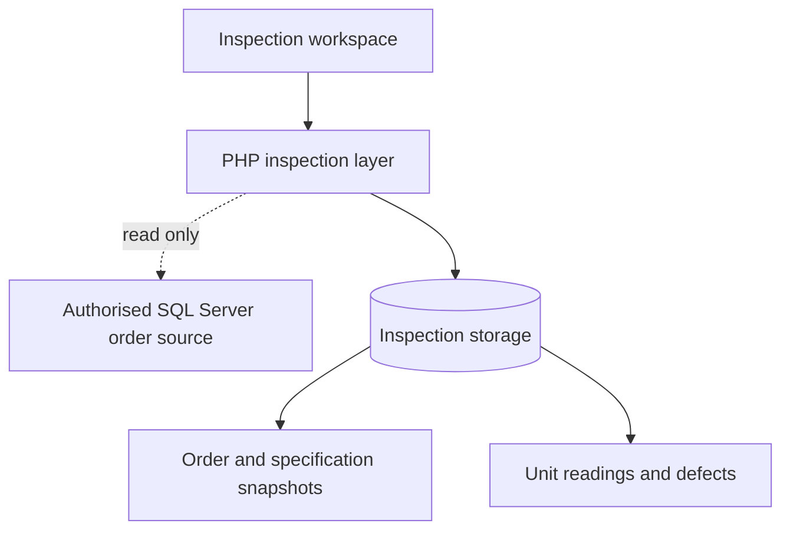

# Engineering notes — QREX CPETPE & HDPE

Built from scratch by Muhammad Zamri Bin Hamzah during a Software Development internship at Top Glove: inspection interfaces, PHP rule/persistence layer, order lookup integration, raw-reading storage, snapshots and workflow validation.

## Architecture



The working application uses Turso/libSQL inspection storage with a read-only order lookup. The public export defaults to local SQLite and fictional master references, with corporate lookup disabled. It can instead use your own Turso database.

## Decision: freeze the original inspection context

**Problem:** Order details and specifications may change after an inspection has started.

**Implementation:** Create an order/specification snapshot with the inspection unit. Store repeated measurements and defects independently and keep unit summary/workflow state associated with that unit.

**Trade-off:** A small amount of context is duplicated. This keeps earlier inspections interpretable using the context they started with.

Source: [`app/Inspections.php`](../app/Inspections.php), [`app/Database.php`](../app/Database.php).

## Decision: keep external order access read-only

The order connector supplies context; inspection writes belong to the application's own store. Searching an order does not itself create a new inspection. Start Inspection creates the snapshot and inspection-unit records.

Source: [`app/Inspections.php`](../app/Inspections.php); database settings are configured privately using [`config/`](../config/).

## Decision: protect workflow state and concurrent edits

**Problem:** A completed record or a stale browser tab should not silently replace current inspection values.

**Implementation:** Check permissions and workflow state in PHP. Completed/submitted records are locked from normal editing. Compare record versions and reject stale saves instead of silently accepting them.

**Trade-off:** An older browser view needs to reload before retrying. Explicit feedback is part of the workflow.

Source: state/version checks in [`app/Inspections.php`](../app/Inspections.php).

## Verification guide

Syntax checks do not require installation or database access:

```sh
php -l app/Inspections.php
php -l app/Database.php
```

After setting up an isolated local database as described in the README, check with fictional records:

1. Start an inspection and inspect its stored order/specification context.
2. Change a current master specification; an existing inspection must retain its starting context.
3. Enter readings for two units; each must retain its own raw values and disposition.
4. Save in one browser tab, then attempt a stale save in another.
5. Complete a record and try a normal edit; verify the server's lock response.
6. Exercise missing readings, zero values, and values exactly at specification boundaries.

These are local acceptance steps, not a claim that the cleaned export has been tested against a company service. Private regression fixtures, production data and credentials are excluded.
